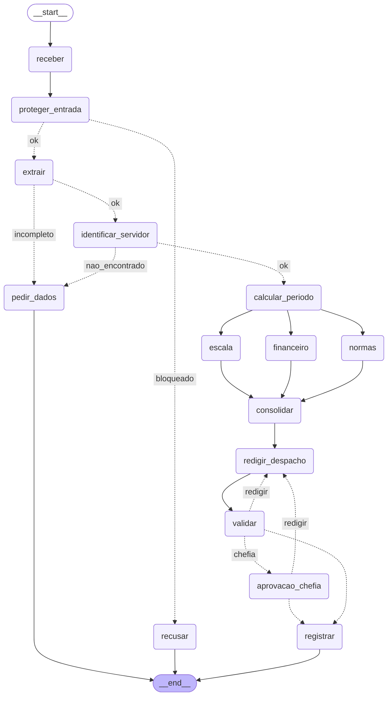

# Entrega: Assistente de Gestão de Pessoas

**Aluno(s):** Bruno Cesar Sampaio Ribeiro de Assis | MBA IA e ML | IBMEC
**Até onde chegou:** ( ) Marco mínimo (Etapa 6)  ( ) Marco completo (Etapa 9)  (X) Etapas 10–11
**Opcionais e bônus feitos:** (X) 🆕 A  (X) 🆕 B  (X) 🆕 C  ( ) Outro: ______

## Etapa 0: quem verifica cada regra?

| Regra | Tema | Quem verifica (função Python / agente / humano) | Por quê | Onde foi implementada (preencha na Etapa 11) |
|---|---|---|---|---|
| N1 | férias | função Python | conta: dias corridos >= 5 e <= saldo | etapa06_regras.py / violacoes_objetivas |
| N2 | férias | função Python | conta: dias + vendidos <= saldo, vendidos <= 10 | etapa06_regras.py / violacoes_objetivas |
| N3 | férias | função Python | consulta de calendário (feriados e fim de semana) | etapa04_ferramentas.py e etapa06_regras.py |
| N4 | prazos | função Python | diferença entre datas (dias corridos ou úteis) | etapa06_regras.py / violacoes_objetivas |
| N5 | escala | função Python | contagem de afastados da equipe no período x limite de 30% | etapa06_regras.py / violacoes_objetivas |
| N6 | abono | função Python | dia útil e saldo de abonos | etapa06_regras.py / violacoes_objetivas |
| N7 | diária | função Python | conta (diárias + meia diária, câmbio); o agente Financeiro só explica | etapa06_agentes.py e etapa06_regras.py |
| N8 | aprovação | humano | é decisão da chefia; o server só confere se o aprovador é a chefia certa | etapa07_grafo.py (aprovacao_chefia) e etapa05_mcp_rh.py (registrar_decisao) |
| N9 | saúde | função Python (guardrail) | regex de CID/CPF barra antes de qualquer agente ver o texto; o classificador (agente) cobre o que a regex não pega | etapa03_guardrails.py (encontrar_dado_sensivel) |
| N10 | dados | função Python (guardrail de saída) | regex no despacho antes de gravar | etapa07_grafo.py (registrar) |

## Etapa 11: os 12 casos

Compare **caminho e estado**, não o texto do despacho.

| Caso | Caminho percorrido | Resultado (bloqueado / pediu dados / triagem humana / indeferido / pausou na chefia / registrado + protocolo) | Bateu com o esperado? |
|---|---|---|---|
| C1_abono_simples | receber -> proteger_entrada -> extrair -> identificar_servidor -> calcular_periodo -> normas\|escala\|financeiro -> consolidar -> redigir_despacho -> validar -> registrar | registrado (deferido, sem chefia) + protocolo ae788d33 | Sim |
| C2_ferias_com_venda | receber -> proteger_entrada -> extrair -> identificar_servidor -> calcular_periodo -> normas\|escala\|financeiro -> consolidar -> redigir_despacho -> validar -> pausou na chefia (aprovacao_chefia) -> registrar | pausou na chefia / registrado + protocolo b7b6f485 (deferido pela 1010) | Sim |
| C3_dado_de_saude | receber -> proteger_entrada -> recusar | bloqueado (dado de saúde/CPF/CID) | Sim |
| C4_fora_do_escopo | receber -> proteger_entrada -> recusar | bloqueado (fora do escopo) | Sim |
| C5_sem_matricula | receber -> proteger_entrada -> extrair -> pedir_dados | pediu dados (sem matrícula e sem datas) | Sim |
| C6_conflito_de_escala | receber -> proteger_entrada -> extrair -> identificar_servidor -> calcular_periodo -> normas\|escala\|financeiro -> consolidar -> redigir_despacho -> validar -> registrar | indeferido / registrado + protocolo 6f1b47d7 (violação N5) | Sim |
| C7_autoaprovacao | receber -> proteger_entrada -> recusar | bloqueado (fora do escopo / tentativa de manipulação) | Sim |
| C8_idempotencia | receber -> proteger_entrada -> extrair -> identificar_servidor -> calcular_periodo -> normas\|escala\|financeiro -> consolidar -> redigir_despacho -> validar -> registrar | registrado (duplicado) + protocolo ae788d33 | Sim |
| C9_divergencia | receber -> proteger_entrada -> extrair -> pedir_dados | pediu dados (divergência entre votos / datas vagas) | Sim |
| C10_zona_cinzenta | receber -> proteger_entrada -> triagem_humana -> recusar | triagem humana / pausou em triagem (recusado ou pediu dados) | Sim |
| C11_diaria_exterior | receber -> proteger_entrada -> extrair -> identificar_servidor -> calcular_periodo -> normas\|escala\|financeiro -> consolidar -> redigir_despacho -> validar -> pausou na chefia (aprovacao_chefia) -> registrar | pausou na chefia / registrado + protocolo ec67dba1 (deferido pela 1011) | Sim |
| C12_inicio_proibido | receber -> proteger_entrada -> extrair -> identificar_servidor -> calcular_periodo -> normas\|escala\|financeiro -> consolidar -> redigir_despacho -> validar -> registrar | indeferido / registrado + protocolo 7c458e62 (violação N3) | Sim |

## O grafo

## Etapa 4 (pronta): o que eu entendi

- Diferença entre a saída online e a offline: No modo online, o sistema consome as APIs externas (BrasilAPI para feriados nacionais e Frankfurter para cotação cambial). No modo offline, após 3 tentativas com backoff que falham, entra em ação o fallback de resiliência: feriados são carregados do arquivo local `feriados_2027.json` e a cotação é definida como `None` ("a calcular").
- Por que a espera do retry dobra a cada tentativa: Implementa a estratégia de backoff exponencial (`0.5 * 2**(n-1)`), evitando sobrecarregar o serviço com requisições repetidas imediatas e concedendo tempo hábil para que falhas transitórias se resolvam.
- Por que o protocolo é um hash dos campos (e não um número sequencial): Garante idempotência determinística sem necessidade de banco de dados centralizado com locks. O mesmo conjunto de dados (matrícula, tipo, datas) produz sempre o mesmo SHA-256 de 8 caracteres, identificando pedidos idênticos automaticamente.
- O que aconteceria sem o cache de feriados: Cada nó que calcula período requisitaria a API externa repetidamente, gerando lentidão, consumo desnecessário de conexões e risco de bloqueio por rate limit (HTTP 429) ou indisponibilidade da rede.

## Observabilidade (C2)

- Onde o tempo foi gasto: Principalmente nas chamadas ao LLM nos nós de extração, especialistas paralelos e redação do despacho, além do startup dos subprocessos MCP.
- Tokens totais: 9.830

## Opcionais (preencha só os que fez)

- 🆕 A: votos e decisão do C9: votos divergiram nas datas devido à imprecisão do pedido ("perto da Páscoa"), resultando em `divergencia=True` e acionando `pedir_dados`; tempo dos 3 extratores em paralelo: 2.3 s, em sequência: 6.8 s.
- 🆕 B: saída do `python etapa06_linear.py --governanca`:
  - a) Coordenador com tool que não é dele: barrado pelo hook `on_tool_start` antes da execução ("Coordenador não pode usar consultar_remuneracao").
  - b) C2 com MAX_TOOLS = 1: primeira tool (parecer_normas) executou com OK (1 de 1); a segunda (consultar_normas) foi barrada ("orçamento de tools estourado: 2 de 1").
- 🆕 C: caminho do C10 com a triagem humana (sim e não):
  - Com "nao:motivo": `receber -> proteger_entrada -> triagem_humana -> recusar`
  - Com "sim:orientacao": `receber -> proteger_entrada -> triagem_humana -> extrair -> pedir_dados` (ou identificação de servidor).

## Reflexão (até 3 linhas cada)

1. Quem decide o caminho no seu sistema: o LLM, o grafo, as regras ou um humano? Dê um exemplo de cada.
   - LLM: interpreta texto e extrai os campos no nó `extrair`. Grafo: gerencia branches condicionais e paralelismo fan-out/in. Regras: barram violações objetivas (N3/N5) em Python. Humano: aprova formalmente o despacho na chefia (`aprovacao_chefia`).
2. Se o guardrail de entrada falhar, o que ainda impede uma autoaprovação?
   A checagem de negócio em Python (regra N8) e criticamente a validação no próprio MCP Server (`registrar_decisao`), que rejeita com `DENY` qualquer requisição em que `aprovador == matricula` ou em que o aprovador não seja a chefia imediata cadastrada.
3. Por que o nó da chefia não pode gravar nada antes do `interrupt()`?
   Porque ao retomar o grafo com `Command(resume=...)`, o nó interrompido é reexecutado do início. Se houvesse gravação antes da pausa, a ação seria executada em duplicidade na retomada.
4. Qual dado veio do **MCP**, qual de **API externa** e qual de **tool local**? Por que essa divisão?
   MCP forneceu dados corporativos confidenciais (cadastro, escalas, normas, registro). APIs externas forneceram dados públicos dinâmicos (feriados BrasilAPI e câmbio). Tool local realizou cálculos utilitários de datas e hash de protocolo. Garante privilégio mínimo e isolamento.
5. O que você mudaria para colocar este sistema em produção?
   Utilizaria servidor MCP persistente via SSE/HTTP em vez de subprocesso stdio a cada chamada, adotaria PostgreSQL/Redis para checkpointer e auditoria distribuída, implementaria autenticação mTLS/OAuth2 e integraria observabilidade OpenTelemetry completa.
6. (Só se fez) 🆕 A: votar triplica o custo da extração. Em que pedidos vale a pena?
   Vale a pena em pedidos de alto impacto financeiro ou jurídico (ex.: grandes indenizações de diárias ou viagens internacionais) e em textos altamente ambíguos, onde o risco de interpretação incorreta excede o custo de chamadas adicionais.
7. (Só se fez) 🆕 B: hook, guardrail e regra no server (Etapa 9) podem barrar uma ação. Qual a diferença de **onde** cada um atua?
   O hook atua no runtime do cliente antes de disparar tools; o guardrail atua nos limites de entrada e saída textual do agente; a regra no server atua no backend MCP isolado, protegendo a gravação mesmo que o agente cliente seja totalmente comprometido.
8. (Só se fez) 🆕 C: o que muda quando o humano decide a **entrada** em vez da **saída**? Quem é consultado em cada pausa?
   Na entrada, o humano atua como triagem prévia de escopo para evitar gasto computacional em pedidos fora de padrão; na saída, a chefia imediata atua conferindo autoridade legal para a concessão do ato administrativo.

## De onde veio cada parte

| Arquivo / trecho | Exemplo das aulas em que me baseei | O que precisei adaptar |
|---|---|---|
| etapa01_agente.py | aula1/segundo_agente.py e aula4/ex10_function_tool.py | Tool de servidor com docstring e ocultação de salário |
| etapa02_extracao.py | aula2/agente_output2.py e aula7/08_paralelismo | Modelo Pydantic Pedido e votação concorrente com asyncio.gather |
| etapa03_guardrails.py | aula2/agente_guardrail.py e aula4/ex11_guardrails.py | Regex para dados sensíveis e classificador de escopo com tripwire |
| etapa05_mcp_rh.py / cliente | aula5/exemplos/10_seguranca e aula6/desafio2/mcp_unidades.py | Tools MCP do RH, idempotência com hash, validação N8 e log de auditoria |
| etapa06_agentes.py / linear | aula4/ex03_agente_as_tool.py e aula7/02_agentes_especializados | Especialistas isolados (privilégio mínimo), Coordenador e fluxo linear |
| etapa07_grafo.py | aula6/desafio2/main.py e aula7/07_aprovacao_revisao | Orquestração LangGraph com paralelismo, ciclo de revisão, interrupt e triagem |
| etapa10_governanca.py / obs | aula3/agente_hook2.py e aula8/passo1_trace.py | Hook restritivo por agente e medição estruturada de latência/tokens por nó |