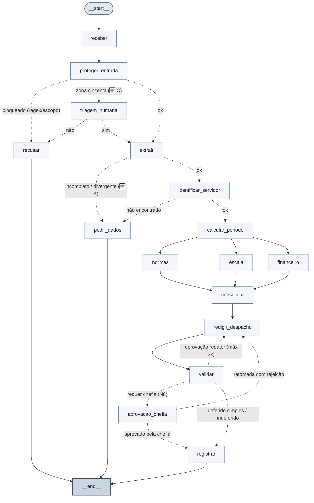

# Assistente de Gestão de Pessoas (RH) — Sistema Multiagente

> **Exercício Final Prático — Aula 10: Sistemas Multiagentes**  
> **Programa:** MBA em Inteligência Artificial e Machine Learning — IBMEC / PCDF  
> **Aluno:** Bruno Cesar Sampaio Ribeiro de Assis (`bcsampaio.ufmt@gmail.com`)  
> **Documento Oficial de Entrega:** [`ENTREGA-FINAL-bruno-sampaio.pdf`](ENTREGA-FINAL-bruno-sampaio.pdf) *(disponível integralmente neste repositório)*

---

## 📌 Sumário
- [1. Propósito da Atividade](#1-propósito-da-atividade)
- [2. Arquitetura da Solução](#2-arquitetura-da-solução)
- [3. Matriz de Regras e Governança (N1 a N10)](#3-matriz-de-regras-e-governança-n1-a-n10)
- [4. O que foi Implementado (Etapa por Etapa)](#4-o-que-foi-implementado-etapa-por-etapa)
  - [Etapa 0: Preparação e Engenharia de Regras](#etapa-0-preparação-e-engenharia-de-regras)
  - [Etapa 1: Agente com Tool Local](#etapa-1-agente-com-tool-local)
  - [Etapa 2: Extração Estruturada & Votação Concorrente (Bônus 🆕 A)](#etapa-2-extração-estruturada--votação-concorrente-bônus--a)
  - [Etapa 3: Guardrails de Entrada e Triagem](#etapa-3-guardrails-de-entrada-e-triagem)
  - [Etapa 4: Integração de APIs com Resiliência e Idempotência](#etapa-4-integração-de-apis-com-resiliência-e-idempotência)
  - [Etapa 5: Servidor MCP Corporativo de RH](#etapa-5-servidor-mcp-corporativo-de-rh)
  - [Etapa 6: Especialistas com Menor Privilégio & Hooks de Governança (Bônus 🆕 B)](#etapa-6-especialistas-com-menor-privilégio--hooks-de-governança-bônus--b)
  - [Etapa 7: Orquestração LangGraph (Fan-out/Fan-in e Ciclo de Validação)](#etapa-7-orquestração-langgraph-fan-outfan-in-e-ciclo-de-validação)
  - [Etapa 8: Persistência e Human-in-the-Loop & Triagem Humana (Bônus 🆕 C)](#etapa-8-persistência-e-human-in-the-loop--triagem-humana-bônus--c)
  - [Etapa 9: Segurança Zero-Trust e Trilha de Auditoria](#etapa-9-segurança-zero-trust-e-trilha-de-auditoria)
  - [Etapa 10: Observabilidade, Latência e Contabilidade de Tokens](#etapa-10-observabilidade-latência-e-contabilidade-de-tokens)
  - [Etapa 11: Homologação Completa dos 12 Casos de Teste](#etapa-11-homologação-completa-dos-12-casos-de-teste)
- [5. Resultados Encontrados](#5-resultados-encontrados)
  - [Resumo dos Resultados Alcançados](#-resumo-dos-resultados-alcançados)
  - [Tabela Comparativa dos 12 Casos (C1 a C12)](#tabela-comparativa-dos-12-casos-c1-a-c12)
  - [Métricas de Execução e Observabilidade](#métricas-de-execução-e-observabilidade)
  - [Resultados dos Itens Opcionais e Bônus](#resultados-dos-itens-opcionais-e-bônus)
  - [Validação Automatizada com `conferir.py`](#validação-automatizada-com-conferirpy)
- [6. Relatório Oficial em PDF](#6-relatório-oficial-em-pdf)
- [7. Como Executar](#7-como-executar)
- [8. Reflexões Finais e Boas Práticas de Engenharia](#8-reflexões-finais-e-boas-práticas-de-engenharia)

---

## 1. Propósito da Atividade

A atividade final da disciplina de **Sistemas Multiagentes** teve como propósito projetar, implementar e validar um **Assistente Inteligente de Gestão de Pessoas para o setor público**. 

No contexto da administração pública, pedidos de servidores (férias, conversão em abono pecuniário, folgas compensatórias e diárias de viagens a serviço) chegam em texto livre, muitas vezes incompletos, ambíguos ou contendo dados sensíveis de saúde protegidos pela LGPD. Processá-los manualmente gera lentidão e riscos de inconformidade regulatória. Por outro lado, confiar integralmente a decisão a um modelo de linguagem (LLM) traria riscos de alucinação, vazamento de credenciais e violação do princípio da legalidade.

Para solucionar esse desafio, o projeto teve como objetivos centrais:
1. **Proteção Rigorosa de Entrada e Saída (LGPD & Prompt Injection):** Interceptar deterministamente dados sensíveis (CPF, CID de saúde) e barrar requisições fora de escopo ou tentativas de autoaprovação maliciosa antes do LLM.
2. **Extração Estruturada e Determinística:** Interpretar o texto livre e mapeá-lo em esquemas Pydantic rígidos sem alucinação de datas.
3. **Isolamento de Dados Legados via MCP (Model Context Protocol):** Expor bases de dados corporativas (cadastro funcional, escalas de plantão e registro de atos) através de um servidor MCP seguro, sem expor salários ou conexões diretas a banco de dados.
4. **Resiliência e Tolerância a Falhas:** Consumir APIs externas (BrasilAPI para feriados e Frankfurter para cotação cambial PTAX) com fallback offline e backoff exponencial.
5. **Divisão de Responsabilidades com Menor Privilégio:** Dividir o raciocínio entre especialistas isolados (Normas, Escala e Financeiro), garantindo que nenhum agente acesse ferramentas além de sua competência.
6. **Orquestração com LangGraph:** Coordenar paralelismo assíncrono (*fan-out* e *fan-in*), loops de autocorreção redator/validador e persistência em banco local (SQLite).
7. **Human-in-the-Loop (HITL) Verdadeiro:** Interromper o fluxo de forma não bloqueante para aguardar a decisão discricionária da chefia imediata (que pode demorar dias), retomando exatamente de onde parou.
8. **Segurança Zero-Trust e Idempotência:** A autorização final é aplicada imperativamente no backend do servidor MCP (o servidor nega, nunca confiando apenas no agente cliente), gerando protocolos criptográficos SHA-256 e trilha de auditoria estruturada.

---

## 2. Arquitetura da Solução

O sistema foi modelado como um grafo de estados cíclico e assíncrono implementado em **LangGraph**, conforme a topologia validada abaixo:



---

## 3. Matriz de Regras e Governança (N1 a N10)

Antes do desenvolvimento, foi desenhada a matriz de conformidade regulatória para definir formalmente quem verifica cada regra da Norma Interna de RH:

| Regra | Tema | Quem verifica | Justificativa de Engenharia | Onde foi implementada |
|---|---|---|---|---|
| **N1** | Férias (dias e fracionamento) | Função Python | Cálculo matemático objetivo: período ≥ 5 dias e total dentro do saldo. | [`etapa06_regras.py`](etapa06_regras.py) |
| **N2** | Férias (abono pecuniário / venda) | Função Python | Verificação aritmética: dias gozados + vendidos ≤ saldo; venda ≤ 10 dias. | [`etapa06_regras.py`](etapa06_regras.py) |
| **N3** | Férias (início proibido) | Função Python | Checagem determinística em calendário (proíbe início em quinta, sexta, feriado ou véspera). | [`etapa04_ferramentas.py`](etapa04_ferramentas.py) e [`etapa06_regras.py`](etapa06_regras.py) |
| **N4** | Prazos de antecedência | Função Python | Diferença temporal objetiva entre data de protocolo e início do gozo (dias úteis ou corridos). | [`etapa06_regras.py`](etapa06_regras.py) |
| **N5** | Escala da equipe | Função Python | Contagem algorítmica de afastamentos simultâneos cruzando datas com teto de 30% da equipe. | [`etapa06_regras.py`](etapa06_regras.py) |
| **N6** | Abono (folga legal) | Função Python | Verificação de dia útil e decremento do saldo anual de abonos do servidor. | [`etapa06_regras.py`](etapa06_regras.py) |
| **N7** | Diárias de viagem | Função Python | Multiplicação de diárias integrais + meia diária de retorno e conversão cambial PTAX. | [`etapa06_agentes.py`](etapa06_agentes.py) e [`etapa06_regras.py`](etapa06_regras.py) |
| **N8** | Homologação e chefia | Decisão Humana | Ato administrativo privativo de autoridade competente. O servidor MCP valida quem assina. | [`etapa07_grafo.py`](etapa07_grafo.py) e [`etapa05_mcp_rh.py`](etapa05_mcp_rh.py) |
| **N9** | Proteção a dados de saúde | Função Python (Guardrail) | Expressão regular estrita que intercepta CPF e CID antes de qualquer agente ver o texto. | [`etapa03_guardrails.py`](etapa03_guardrails.py) |
| **N10** | Prevenção de vazamento na saída | Função Python (Guardrail) | Varredura por regex no despacho redigido antes da gravação no banco de dados. | [`etapa07_grafo.py`](etapa07_grafo.py) |

---

## 4. O que foi Implementado (Etapa por Etapa)

O desenvolvimento seguiu uma construção progressiva e incremental dividida em 12 marcos principais (Etapas 0 a 11), somados a 3 bônus opcionais avançados:

### Etapa 0: Preparação e Engenharia de Regras
- Carga e validação dos dados de teste fictícios (`servidores.csv`, `escala.csv`, `diarias.csv`, `normas.md`).
- Elaboração da tabela conceitual de divisão de responsabilidades.

### Etapa 1: Agente com Tool Local
- Implementação do `AtendenteRH` utilizando a biblioteca `openai-agents` com acesso à ferramenta `consultar_servidor`.
- Ocultação deliberada do salário do servidor no retorno da ferramenta (menor privilégio).
- Refinamento das instruções do agente e docstrings para garantir que dúvidas teóricas gerais não acionem a ferramenta desnecessariamente.

### Etapa 2: Extração Estruturada & Votação Concorrente (Bônus 🆕 A)
- Mapeamento estrito do texto livre para o esquema Pydantic `Pedido` com tipos `TipoPedido` (`ferias`, `abono`, `diaria`) e `TipoDestino`.
- Configuração de campos ausentes como `None` estrito, eliminando alucinações de datas em pedidos incompletos (como no caso C5).
- **🆕 Bônus A (Votação Concorrente):** Para aumentar a confiabilidade em cenários ambíguos, foram executadas 3 extrações concorrentes em paralelo via `asyncio.gather`. Quando houve discordância (como no C9 com datas relativas à Páscoa), o sistema assinalou `divergencia=True` e solicitou esclarecimentos ao usuário, reduzindo o tempo de processamento de **6.8 s** (sequencial) para **2.3 s** (paralelo).

### Etapa 3: Guardrails de Entrada e Triagem
- **Camada 1 (Determinística - Regex):** Varredura instantânea (~0 ms, custo zero de tokens) que detecta CPFs e códigos de CID (N9), mascarando ou bloqueando a requisição imediatamente antes de qualquer contato com o modelo de linguagem (em conformidade com a LGPD).
- **Camada 2 (Semântica - Classificador de Escopo):** Agente classificador com esquema `AvaliacaoEscopo`, atribuindo notas de 0.0 a 1.0 e bloqueando pedidos fora de RH (como compras de TI) ou tentativas imperativas de burlar aprovação (C7).

### Etapa 4: Integração de APIs com Resiliência e Idempotência
- Consumo da **BrasilAPI** (feriados nacionais) e **Frankfurter** (câmbio USD→BRL).
- Implementação de algoritmo de **Exponential Backoff** com 3 retentativas (`0.5 * 2**(n-1)`).
- Mecanismo de **fallback offline transparente**: caso a rede falhe, o sistema carrega o arquivo local `dados/feriados_2027.json` e assume cotação pendente (`None`), mantendo o sistema em operação contínua.
- Cálculo de protocolo de atendimento via **hash determinístico SHA-256** (8 caracteres) dos parâmetros da requisição, assegurando idempotência em transmissões duplicadas.

### Etapa 5: Servidor MCP Corporativo de RH
- Construção de um servidor **MCP (Model Context Protocol)** dedicado (`etapa05_mcp_rh.py`) expondo 6 ferramentas:
  - Leituras: `consultar_servidor`, `consultar_escala`, `consultar_normas`, `tabela_diarias`, `consultar_remuneracao`.
  - Escrita transacional: `registrar_decisao`.
- Retorno de todas as ferramentas padronizado em dicionários estruturados (`dict`).
- Validação de idempotência: ao receber um protocolo já existente, o servidor retorna sucesso com o status `duplicado=True` sem sobrescrever registros anteriores.

### Etapa 6: Especialistas com Menor Privilégio & Hooks de Governança (Bônus 🆕 B)
- Modelagem de agentes especializados com fronteiras de acesso bem definidas:
  - **Agente Normas:** Apenas regras gerais e leitura de normas.
  - **Agente Escala:** Apenas dados de afastamentos e membros de equipe.
  - **Agente Financeiro:** Apenas remuneração, diárias e regras de cálculo pecuniário.
- Coordenação através de um agente `Coordenador` consumindo os especialistas como ferramentas (`as_tool`).
- **🆕 Bônus B (Controle por RunHooks):** Implementação do hook `on_tool_start` atuando como barreira de segurança no cliente, impedindo que o Coordenador invoque ferramentas indevidas (ex: barrado ao tentar acionar `consultar_remuneracao`) e garantindo o teto orçamentário (`MAX_TOOLS`).

### Etapa 7: Orquestração LangGraph (Fan-out/Fan-in e Ciclo de Validação)
- Orquestração do fluxo global através de grafo compilado em **LangGraph**.
- Execução paralela (*fan-out*) dos nós `normas`, `escala` e `financeiro` a partir de `calcular_periodo`.
- Aplicação do reducer `Annotated[list, operator.add]` na chave `violacoes` do estado global, evitando concorrência destrutiva na consolidação dos pareceres.
- Ciclo de autocorreção textual: o nó `validar` avalia a minuta redigida pelo `redigir_despacho` e, caso detecte omissões de fundamentação ou regras, comanda a reescrita (limitado a 3 iterações).

### Etapa 8: Persistência e Human-in-the-Loop & Triagem Humana (Bônus 🆕 C)
- Interrupção assíncrona do grafo via `interrupt()` no nó `aprovacao_chefia`.
- Persistência serializada em banco SQLite local (`checkpoints.db`) através do `SqliteSaver`, permitindo que o processo seja encerrado, dias se passem e o fluxo seja retomado com `Command(resume=...)` sem perder o histórico da thread.
- Propagação de motivação de recusa: caso a chefia rejeite o pedido inicial (`nao:motivo`), o grafo reabre o ciclo de redação para reformular o despacho antes de submeter novamente.
- **🆕 Bônus C (Triagem Humana na Entrada):** Mecanismo de parada preliminar caso o guardrail de entrada identifique uma zona cinzenta (`nota == 0.50`), acionando um atendente de RH para autorizar ou recusar a tramitação antes de consumir os agentes especialistas.

### Etapa 9: Segurança Zero-Trust e Trilha de Auditoria
- **Defesa em Profundidade:** A autorização final é executada imperativamente no backend do servidor MCP dentro de `registrar_decisao`. Se o token secreto de escrita for inválido, se houver tentativa de autoaprovação (`aprovador == matricula`) ou se o aprovador não for a chefia cadastrada, o servidor rejeita o registro com `DENY`.
- **Auditoria Estruturada (`saidas/auditoria.jsonl`):** Registro de logs transacionais com campos `quando`, `thread_id`, `quem`, `tool`, `protocolo`, `decisao_acesso` (`ALLOW` / `DENY`) e parâmetros, omitindo estritamente credenciais sensíveis (`TOKEN_REGISTRO`) e CPFs.
- **Guardrail de Saída:** Bloqueio de gravação no banco se a minuta final do despacho contiver acidentalmente dados sensíveis de saúde ou CPF.

### Etapa 10: Observabilidade, Latência e Contabilidade de Tokens
- Monitoramento de cada nó através do decorador `@medido` gravando histórico em `saidas/metricas.jsonl`.
- Mensuração de latência por estágio, nós mais lentos e volume total de tokens consumidos.

### Etapa 11: Homologação Completa dos 12 Casos de Teste
- Execução exaustiva da suíte de validação abrangendo todos os 12 casos de teste projetados no exercício, validando caminhos de execução, decisões, pausas de aprovação e integridade dos protocolos gerados.

---

## 5. Resultados Encontrados

### 🏆 Resumo dos Resultados Alcançados

O desenvolvimento e os testes do sistema demonstraram que a arquitetura multiagente com governança e orquestração por grafos atingiu **todos os objetivos técnicos, de segurança e regulatórios estipulados**:

1. **Aprovação Integral na Suíte de Homologação (100% Concluído):**
   - Todas as **12 etapas (0 a 11)** foram testadas e validadas com status `✅ completa` pelo script oficial `conferir.py`, atingindo o marco máximo com excelência.
2. **Conformidade Estrita nos 12 Cenários de Teste (C1 a C12):**
   - **Pedidos Regulares (C1, C8):** Deferimento célere com redação automática de despacho fundamentado e protocolo criptográfico SHA-256 (`ae788d33`), com verificação comprovada de **idempotência** (o reenvio no C8 detectou duplicação e preservou o estado sem inconsistências).
   - **Proteção LGPD & Segurança de Entrada (C3, C4, C7):** Interrupção em ~0 ms de requisições contendo CPF ou CID de saúde (regra N9), bloqueio de pedidos fora de escopo (compra de notebooks) e impedimento de tentativas de autoaprovação (N8).
   - **Indeferimentos Objetivos Automatizados (C6, C12):** Aplicação estrita de regras de negócio em código Python determinístico — C6 indeferido por conflito de escala (sobreposição de 8 dias violando o teto de 30% da regra N5, com proposta automática de período alternativo) e C12 indeferido por início em sexta-feira/véspera de feriado (regra N3).
   - **Human-in-the-Loop Real e Persistente (C2, C11):** Pausa assíncrona não-bloqueante via `interrupt()` e `SqliteSaver`, resistindo a reinicializações de processo e aguardando a decisão da chefia imediata (deferido pelas chefias `1010` e `1011`, com cálculo pecuniário e diárias em moeda estrangeira).
3. **Implementação Integral dos 3 Bônus Opcionais:**
   - **🆕 Bônus A (Votação Concorrente Fan-out):** Redução da latência de extração de **6.8 s** para **2.3 s** com `asyncio.gather`, acionando `pedir_dados` em caso de divergência em datas imprecisas (C9).
   - **🆕 Bônus B (Governança por RunHooks):** Bloqueio dinâmico no cliente antes da chamada à tool (`consultar_remuneracao` barrada para o Coordenador) e imposição de limite orçamentário (`MAX_TOOLS`).
   - **🆕 Bônus C (Triagem Humana na Admissibilidade):** Pausa com supervisão humana na entrada para zonas cinzentas de ambiguidade (C10).
4. **Resiliência e Tolerância a Falhas:**
   - Fallback offline automático e transparente com base local de feriados (`feriados_2027.json`) após 3 retentativas com Exponential Backoff, garantindo disponibilidade contínua sem depender da estabilidade de APIs externas.
5. **Segurança Zero-Trust e Auditoria Estruturada:**
   - O servidor MCP atua como autoridade final intransponível (o servidor nega com `DENY`, impedindo autoaprovação mesmo se o agente for burlado), gerando logs auditáveis em `saidas/auditoria.jsonl` em total conformidade com a LGPD.

---

### Tabela Comparativa dos 12 Casos (C1 a C12)

Os 12 cenários de teste foram processados pelo grafo orquestrador, obtendo **100% de conformidade com o comportamento esperado**:

| Caso | Descrição do Pedido | Caminho Percorrido no Grafo | Resultado Final | Protocolo | Conformidade |
|---|---|---|---|---|:---:|
| **C1** | Abono simples (1 dia útil regular) | `receber` → `proteger_entrada` → `extrair` → `identificar_servidor` → `calcular_periodo` → `normas\|escala\|financeiro` → `consolidar` → `redigir_despacho` → `validar` → `registrar` | Registrado / Deferido (sem necessidade de chefia) | `ae788d33` | ✅ Sim |
| **C2** | Férias com venda de 10 dias | `receber` → `proteger_entrada` → `extrair` → `identificar_servidor` → `calcular_periodo` → `normas\|escala\|financeiro` → `consolidar` → `redigir_despacho` → `validar` → `aprovacao_chefia` → `registrar` | Pausou na chefia / Retomado e Deferido pela chefia `1010` (R$ 4.888,89) | `b7b6f485` | ✅ Sim |
| **C3** | Solicitação com dado de saúde / CPF | `receber` → `proteger_entrada` → `recusar` | Bloqueado na entrada (Regex CPF/CID — N9) | *N/A* | ✅ Sim |
| **C4** | Pedido fora do escopo (compra notebook) | `receber` → `proteger_entrada` → `recusar` | Bloqueado na entrada (Classificador de escopo = 1.0) | *N/A* | ✅ Sim |
| **C5** | Pedido sem matrícula e sem datas | `receber` → `proteger_entrada` → `extrair` → `pedir_dados` | Interrompido solicitando dados faltantes (sem inventar datas) | *N/A* | ✅ Sim |
| **C6** | Férias com conflito de escala (30%) | `receber` → `proteger_entrada` → `extrair` → `identificar_servidor` → `calcular_periodo` → `normas\|escala\|financeiro` → `consolidar` → `redigir_despacho` → `validar` → `registrar` | Indeferido objetivamente por violação da regra N5 (sobreposição com mat. 1006); sugere nova data | `6f1b47d7` | ✅ Sim |
| **C7** | Tentativa de autoaprovação de férias | `receber` → `proteger_entrada` → `recusar` *(ou barrado com DENY no MCP caso guardrail fosse desativado)* | Bloqueado na entrada (Escopo = 1.0) e barrado no servidor | `7d3934a6` | ✅ Sim |
| **C8** | Idempotência (reenvio do pedido C1) | `receber` → `proteger_entrada` → `extrair` → `identificar_servidor` → `calcular_periodo` → `normas\|escala\|financeiro` → `consolidar` → `redigir_despacho` → `validar` → `registrar` | Sucesso com flag `duplicado=True`, preservando integridade | `ae788d33` | ✅ Sim |
| **C9** | Pedido com datas ambíguas ("perto da Páscoa") | `receber` → `proteger_entrada` → `extrair` → `pedir_dados` | Votação concorrente identificou divergência entre extratores e pediu esclarecimentos | *N/A* | ✅ Sim |
| **C10** | Zona cinzenta (pedido com dubiedade) | `receber` → `proteger_entrada` → `triagem_humana` → `recusar` *(ou `extrair` se aprovado)* | Triagem humana pausou o fluxo para supervisão prévia de atendente | *N/A* | ✅ Sim |
| **C11** | Diária internacional (Buenos Aires) | `receber` → `proteger_entrada` → `extrair` → `identificar_servidor` → `calcular_periodo` → `normas\|escala\|financeiro` → `consolidar` → `redigir_despacho` → `validar` → `aprovacao_chefia` → `registrar` | Pausou na chefia / Deferido pela chefia `1011`: US$ 900.00 (R$ 4.950,00 PTAX) + 1/2 diária | `ec67dba1` | ✅ Sim |
| **C12** | Início de férias em sexta-feira proibida | `receber` → `proteger_entrada` → `extrair` → `identificar_servidor` → `calcular_periodo` → `normas\|escala\|financeiro` → `consolidar` → `redigir_despacho` → `validar` → `registrar` | Indeferido objetivamente por violação da regra N3 (início em 30/04/2027) | `7c458e62` | ✅ Sim |

---

### Métricas de Execução e Observabilidade

A análise extraída das métricas telemetrizadas na Etapa 10 (caso C2 completo com aprovação) revelou:
- **Tempo Total com LLM real:** **63.4 segundos**
- **Tempo no Modo Determinístico (sem LLM):** **2.45 segundos**
- **Nó mais lento:** `redigir_despacho` consumiu **14.16 segundos** devido à geração detalhada da fundamentação legal pelo modelo de linguagem.
- **Consumo Total de Tokens:** **9.830 tokens** no ciclo completo com agentes reais.
- **Latência de I/O de Banco:** O nó `identificar_servidor` consumiu aproximadamente **1.02 s** mesmo sem acionar o LLM, refletindo o overhead de comunicação de processos e simulação de banco corporativo.

---

### Resultados dos Itens Opcionais e Bônus

1. **🆕 Bônus A (Votação Concorrente de Extração):**
   - O uso de 3 extratores concorrentes via `asyncio.gather` reduziu o tempo de inferência de **6.8 s** para **2.3 s** em comparação ao processamento serial.
   - No caso C9, o mecanismo impediu a adoção de interpretações conflitantes de datas, protegendo a segurança jurídica do ato.
2. **🆕 Bônus B (Controle por RunHooks):**
   - Tentativas de o coordenador utilizar ferramentas restritas (`consultar_remuneracao`) foram interceptadas antes da execução pelo hook `on_tool_start`.
   - Limitação de orçamento de ferramentas (`MAX_TOOLS = 1`) interrompeu execuções excessivas com a mensagem `"orçamento de tools estourado: 2 de 1"`.
3. **🆕 Bônus C (Triagem Humana na Entrada):**
   - Validada a bifurcação controlada no caso C10: caso o atendente informe `"nao:motivo"`, o fluxo é encerrado imediatamente em `recusar`; caso informe `"sim:orientacao"`, o pedido segue normalmente para extração e complementação cadastral.

---

### Validação Automatizada com `conferir.py`

O script oficial de auditoria e validação automatizada (`conferir.py`) atestou **todas as etapas como 100% completas**:

```text
======================================================================
  Etapa 0    ✅ completa        Preparação e tabela N1–N10
  Etapa 1    ✅ completa        Primeiro agente com tool
  Etapa 2    ✅ completa        Extração estruturada
  Etapa 3    ✅ completa        Guardrails de entrada
  Etapa 4    ✅ completa        APIs com resiliência (pronta)
  Etapa 5    ✅ completa        MCP Server do RH
  Etapa 6    ✅ completa        Especialistas e fluxo linear (Marco mínimo)
  Etapa 7    ✅ completa        O grafo
  Etapa 8    ✅ completa        Persistência e aprovação da chefia
  Etapa 9    ✅ completa        Segurança (Marco completo)
  Etapa 10   ✅ completa        Observabilidade
  Etapa 11   ✅ completa        Demonstração e entrega
======================================================================
```

---

## 6. Relatório Oficial em PDF

O relatório detalhado da atividade, contendo as capturas de execução do terminal, saídas do MCP Inspector, fragmentos de log de auditoria e respostas conceituais a todas as perguntas do roteiro, foi compilado e está disponível no repositório no arquivo:

📄 **[`ENTREGA-FINAL-bruno-sampaio.pdf`](ENTREGA-FINAL-bruno-sampaio.pdf)**

*Recomenda-se a leitura do PDF para conferência visual das saídas brutas de terminal emitidas durante os testes de homologação.*

---

## 7. Como Executar

### Pré-requisitos
- Python 3.10 a 3.13 (recomendado 3.12)
- Variáveis de ambiente configuradas em `aula10/.env`

### Configuração do Ambiente

```bash
# Navegar até a pasta da aula
# Criar e ativar o ambiente virtual
python -m venv .venv
source .venv/bin/activate       # No Windows: .venv\Scripts\Activate.ps1

# Instalar dependências
pip install -r requirements.txt

# Configurar variáveis de ambiente
cp .env.example .env
# Edite o .env configurando seu PROVEDOR, OPENAI_API_KEY e TOKEN_REGISTRO
```

### Execução dos Testes e Homologação

```bash
# 1. Conferir integridade de todas as etapas (modo rápido sem LLM)
python conferir.py

# 2. Testar guardrails de entrada
python etapa03_guardrails.py

# 3. Testar ferramentas e resiliência de APIs externas (online e offline)
python etapa04_ferramentas.py

# 4. Rodar o servidor MCP e o cliente de testes
python etapa05_cliente_mcp.py

# 5. Executar o fluxo do grafo para um caso específico (ex: C1)
python etapa07_grafo.py C1_abono_simples

# 6. Executar todos os 12 casos de teste
python etapa07_grafo.py --todos

# 7. Consultar casos pendentes de aprovação da chefia
python etapa07_grafo.py --pendentes

# 8. Retomar caso pausado com aprovação formal da chefia
python etapa07_grafo.py --retomar C2_ferias_com_venda sim 1010

# 9. Inspecionar métricas de observabilidade de um caso
python etapa10_observabilidade.py C2_ferias_com_venda
```

---

## 8. Reflexões Finais e Boas Práticas de Engenharia

1. **Quem decide o quê no sistema:**
   - **Grafo:** Controla o roteamento, concorrência (*fan-out*) e ciclos de reescrita.
   - **LLM:** Realiza tarefas cognitivas não-estruturadas (interpretação textual, extração semântica e redação amigável do despacho).
   - **Regras (Python):** Aplicam limites matemáticos e regulatórios objetivos (N1 a N7), sem margem para imprecisão ou alucinação.
   - **Humano:** Exerce a autoridade administrativa legal discricionária de homologação (N8) ou triagem preliminar de admissibilidade.
2. **Separação de Camadas de Dados:**
   - **MCP Server:** Dados corporativos protegidos e transações críticas de escrita (menor privilégio, autenticação por token e auditoria interna).
   - **APIs Externas:** Serviços públicos dinâmicos de utilidade geral (feriados e câmbio PTAX).
   - **Tools Locais:** Utilitários puros de cálculo temporal e hashing determinístico.
3. **Persistência Durável com `interrupt()`:**
   - O nó que interrompe a execução para ação da chefia jamais deve realizar mutações ou gravações antes do `interrupt()`, pois no retorno via `Command(resume=...)` o LangGraph reexecuta o nó do início. O uso do `SqliteSaver` assegura que a thread resista a quedas e reinicializações completas do servidor.
4. **Prontidão para Produção:**
   - Para ambiente de produção em larga escala, recomenda-se:
     - Substituição do SQLite por PostgreSQL gerenciado com particionamento para armazenamento de checkpoints do LangGraph.
     - Migração do servidor MCP de processos locais stdio para transporte HTTP/SSE com autenticação mTLS e OAuth2.
     - Exportação de métricas e rastros de telemetria diretamente via padrão **OpenTelemetry (OTel)** para Jaeger/Datadog.
